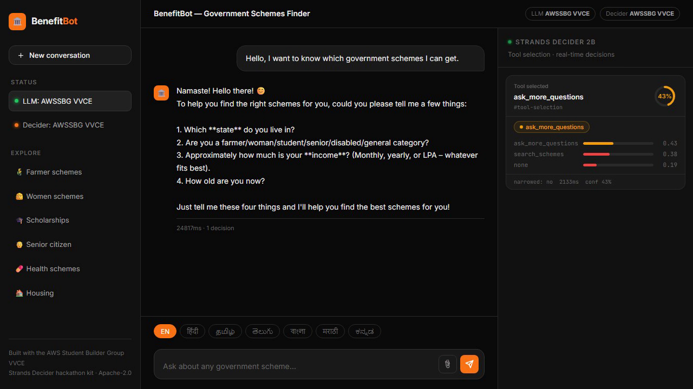
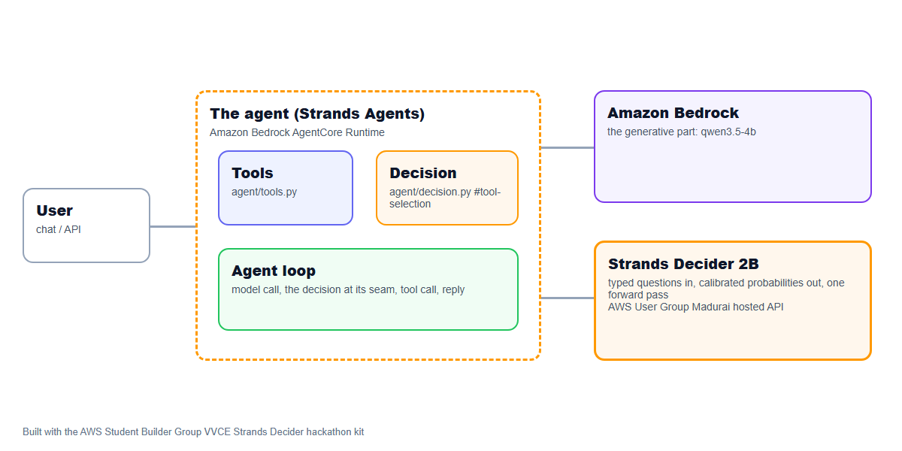

# BenefitBot

**BenefitBot helps rural Indians discover government schemes they may be eligible for,**

An agent on AWS that hands one decision to **Strands Decider 2B** and the conversation to **Amazon Bedrock**. Decision pattern: `#tool-selection`. Tags: `#strands-decider-2b` `#tool-selection`.

- Video: (add the YouTube/Vimeo link)
- Article: (add the AWS Builder Center link)
- Deployed: Amazon Bedrock AgentCore Runtime, us-east-1

## The project

- **Pitch:** BenefitBot helps rural Indians discover government schemes they may be eligible for,
  get a personalised document checklist, and receive everything in their preferred language.
- **Who it is for:** Rural individuals in India with limited digital literacy, and social workers
  or NGO volunteers helping beneficiaries navigate central and state government schemes.
- **Features:**
  - asks the user a few conversational questions to build a profile (state, age, occupation,
    income, category);
  - Strands Decider 2B picks the right search tool for each profile — central schemes, state
    schemes, both, or "ask one more question" — before the LLM turn;
  - returns matched schemes with potential vs confirmed eligibility clearly distinguished;
  - generates a personalised document checklist and application guide per scheme;
  - responds in the user's preferred language (English default; Hindi, Tamil, Telugu, Bengali,
    Marathi on request);
  - deployed on Amazon Bedrock AgentCore Runtime with Memory so the profile is remembered
    across sessions.
- **The decision handed to Strands Decider 2B:** given the user profile collected so far, which
  tool should handle this request — search central schemes, search state schemes, search both,
  or ask the user one more clarifying question? (`#tool-selection`)
- **Why a decision model:** the tool selection runs on every turn; it must be fast, cheap and
  correct. A specialised 2B model is far cheaper and faster than asking the full LLM to pick.
- **Amazon Bedrock:** the conversation and tool use (Amazon Nova Pro on deployment).



## How it is built

Strands Agents with Amazon Bedrock for the generative part, the tools in `agent/tools.py`, deployed to Amazon Bedrock AgentCore Runtime, and one decision handed to Strands Decider 2B at a clear seam in the agent's path.

Amazon Bedrock AgentCore features: AgentCore Memory (SEMANTIC, USER_PREFERENCE strategies) (configured in `agent/features.yaml`, created by `./kit deploy`).

Every Amazon Bedrock model id is set in `.env` (`BEDROCK_MODEL_ID`, and `BEDROCK_SMALL/MEDIUM/LARGE_MODEL_ID` for routing), Amazon Nova by default.



## Reusable decision pattern: scheme tool selection  (#tool-selection)

The pattern lives in [`agent/decision.py`](agent/decision.py), labelled `REUSABLE DECISION PATTERN`. It contains the typed questions and their options, the wiring that puts the decision in the agent's path, and a note on how to reuse it:

```text
REUSABLE DECISION PATTERN: scheme tool selection  (#tool-selection)

What it does
    Before BenefitBot searches for Indian government schemes, Strands Decider 2B reads the
    user's profile collected so far and picks which tool to call:

        search_schemes       — the user's state is known; search central + state schemes now
        ask_more_questions   — key profile fields (especially state) are missing; ask first

    This single binary decision keeps the choice sharp and the decider confident. When
    confidence is below the threshold (0.6), all tools are kept and the LLM decides,
    so no opportunity is lost.

Typed questions and options
    `tool` (choice): built from the two tools' docstrings by `questions_for()` from
    `decider_kit.patterns.tool_selection`, plus `none` (answer directly).

Wiring (where it sits in the agent's path)
    Between the user message and the Strands Agent:

        from agent.decision import selector_for
        selector = selector_for(decider)
        narrowed_tools = selector.tools_for(user_message, history=conversation_history)
        agent = Agent(model=..., tools=narrowed_tools + [get_document_checklist, get_user_profile])
        result = agent(user_message)

How to reuse it in your own agent
    1. Replace search_schemes and ask_more_questions with your own tools.
    2. Give every tool a clear one-line docstring: that line becomes the option the decider
       reads when picking.
    3. Adjust the `context` hint in `selector_for` to describe your domain.
    4. Tune `threshold` (default 0.6): lower → LLM decides more often; higher → decider
       narrows more aggressively.
    5. Keep the state sent to the decider short and factual — no LLM-invented inferences.
```

Typed questions:

```python
QUESTIONS = {
    "tool": Decider.choice(
        "Given the user profile, which tool should the agent call next?",
        {
            "search_schemes": (
                "the user's state IS known — search central and state government schemes now"
            ),
            "ask_more_questions": (
                "the user's state is unknown OR key profile fields are missing — "
                "ask the user one clarifying question before searching"
            ),
            "none": "no tool needed; the agent can answer directly",
        },
    )
}
```

## Measured

Decider: strands-decider-2b-hobson-v19 (ugmdu). 14 labelled cases, 14 decisions.

| | Strands Decider 2B | qwen3.5-4b |
|---|---|---|
| Accuracy | 92.9% | 100.0% |
| Latency p50 per decision | 1878 ms | 11200 ms |
| Latency p95 | 1995 ms | 11500 ms |
| Cost per 1,000 decisions | $0.0350 | $0.0000 |
| Answered alone at confidence >= 0.7 | 57% | 100% |
| Accuracy when confident | 100.0% | 100.0% |

At the median the decider was 6.0x faster than the LLM.

Reproduce with `./kit bench` (cases in `agent/eval_cases.jsonl`; charts in `submission/bench/`).

## Run it

```bash
./kit setup        # checks your machine and AWS, sets up Strands Decider 2B (local model or hosted API)
./kit demo         # web UI at http://localhost:8501
./kit bench        # the decision vs an Amazon Bedrock LLM
./kit deploy       # Amazon Bedrock AgentCore Runtime
```

Requirements: Python 3.10+, AWS credentials with Amazon Bedrock access, and for deploying, Node 20+ with the AgentCore CLI (`./kit agentcore-cli`).

## Credits

Built with the AWS Student Builder Group VVCE Strands Decider hackathon kit (https://github.com/awsugmdu). The kit's reusable library (`decider_kit/`, the demo UI, the video and article tooling, and the Kiro steering, skills and hooks) is the user group's; the agent in `agent/` is mine. Strands Decider: https://github.com/strands-labs/strands-decider (Apache-2.0).

Licence: Apache-2.0 (see LICENSE).
